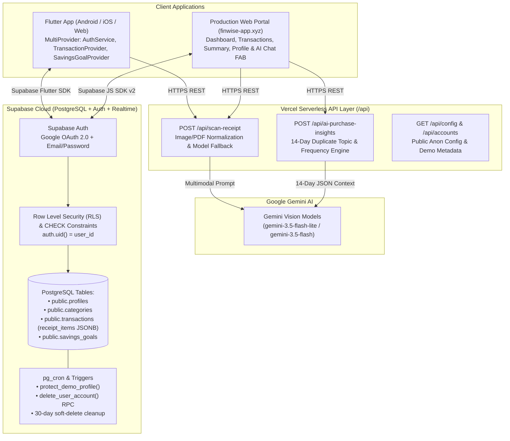

# 💰 FinWise — AI-Powered Personal Financial Intelligence

> **Smart Cross-Platform Financial Management, Itemized Receipt OCR & Real-Time Budget Tracking System**  
> Built with **Flutter**, **Supabase (PostgreSQL + Realtime + Auth)**, and **Google Gemini Vision AI** (`https://www.finwise-app.xyz`)

---

## 👥 Project Team & Architecture Roles

| Role | Primary Module |
| :--- | :--- |
| **Project Lead & Backend Architect** | Authentication, CIA Triad Security, RLS & Supabase Cloud Sync |
| **Frontend & Analytics Lead** | Real-Time Expense Tracker, Itemized Ledger & AI Purchase Insights |
| **AI & Simulation Lead** | Gemini Vision Receipt OCR, What-If Financial Simulator & Cash-Flow Forecasting |
| **Quality Assurance & UI/UX Lead** | Material 3 Responsive Design, Savings Goals & End-to-End Widget Testing |

---

## 📖 Project Overview

**FinWise** is a cross-platform financial literacy, expense tracking, and AI advisory platform engineered for university students (including UTM students) and young professionals. FinWise bridges the gap between manual bookkeeping and automated financial intelligence by combining a **Flutter mobile/multi-platform client** and a **cloud-synced Web Portal** with **Google Gemini Vision OCR** and **Supabase PostgreSQL**.

### Core Problems Solved
- **Receipt Amnesia**: Instead of only logging a lump-sum total (e.g., `RM 224.00` at AEON), FinWise extracts every individual line item (`1x Nike Sneakers`, `2x Colgate Toothpaste`) into a structured `JSONB` array (`receipt_items`) and displays them in a clean, minimalist expandable card view.
- **Repetitive Impulse Spending**: A 14-day AI Purchase Pattern Agent scans itemized receipt history to detect duplicate or high-frequency purchases (such as buying footwear or specialty coffee multiple times within two weeks) and delivers friendly, proactive budget advice.
- **Cross-Device Sync & Strict Isolation**: Every transaction, profile setting, and savings goal synchronizes in real time via Supabase while enforcing strict Row Level Security (`auth.uid() = user_id`).

---

## 🛠️ Tech Stack

| Layer | Technology | Purpose |
| :--- | :--- | :--- |
| **Mobile & Cross-Platform UI** | **Flutter 3.x (Dart)**, `provider`, Material 3, Google Fonts (`Inter`) | Cross-platform Android, iOS, Web & Desktop application with reactive `ChangeNotifier` state management |
| **Web Portal** | **HTML5, Tailwind CSS, Vanilla ES6+, WebRTC Camera API, Web Speech API** | Zero-build responsive web application with live webcam viewfinder and voice-to-expense AI chat |
| **Backend & Database** | **Supabase (PostgreSQL 15, PostgREST, Realtime, pg_cron)** | Relational storage, `JSONB` line-item indexing, database triggers, `SECURITY DEFINER` RPCs, and live websockets |
| **Authentication** | **Supabase Auth + Google OAuth 2.0 (`google_sign_in`)** | Passwordless Google Gmail sign-in, SHA-256 / bcrypt email-password dual login, and automated session scrubbing |
| **AI & OCR Engine** | **Google Gemini Vision API (`gemini-3.5-flash-lite` / `gemini-3.5-flash`)** | Multimodal receipt/invoice/PDF extraction (`response_mime_type: application/json`) & 14-day behavioral insights |
| **Hosting & Serverless** | **Vercel Serverless Functions (`Node.js`)** | Secure server-side Gemini API proxy (`/api/scan-receipt`, `/api/ai-purchase-insights`) & edge routing |

---

## 🏗️ System Architecture



### Repository Directory Structure

```text
FinWise/
├── lib/                                   # Cross-Platform Flutter Application
│   ├── main.dart                          # App entry point, Supabase init, MultiProvider & named routes
│   ├── theme/app_theme.dart               # Material 3 theme & AppColors design tokens
│   ├── models/                            # Immutable data models & JSON/Supabase serializers
│   │   ├── category_item.dart             # 12 default income/expense categories with icons & colors
│   │   ├── transaction_record.dart        # Transaction model + receipt_items JSONB & Details parser
│   │   ├── savings_goal.dart              # Savings goal model with computed progress & GoalStatus
│   │   └── user_profile.dart              # User profile & budget preferences model
│   ├── providers/                         # Reactive state management (ChangeNotifier)
│   │   ├── transaction_provider.dart      # CRUD state, deep line-item search & 14-day AI insights
│   │   └── savings_goal_provider.dart     # Savings goals state, active/completed/overdue filters
│   ├── services/                          # Backend & authentication singletons
│   │   ├── supabase_service.dart          # Supabase client initialization & connectivity diagnostics
│   │   ├── auth_service.dart              # Google OAuth, Email/Password, Profile update & Account purge
│   │   ├── database_service.dart          # Transactions & Profile CRUD with validation & local fallback
│   │   └── savings_goal_service.dart      # Savings goals Supabase CRUD & deposit logic
│   ├── screens/                           # Application UI screens
│   │   ├── main_navigation_shell.dart     # Bottom navigation bar & IndexedStack host
│   │   ├── login_screen.dart              # Google Sign-In, Email login dialog & demo picker
│   │   ├── register_screen.dart           # Onboarding, Google Sign-Up & live password strength meter
│   │   ├── forgot_password_screen.dart    # Password reset email flow with 60s cooldown timer
│   │   ├── dashboard_screen.dart          # Net balance hero card, quick services, filters & ledger
│   │   ├── add_transaction_screen.dart    # Full expense/income form with Details line-item parser
│   │   ├── receipt_scanner_screen.dart    # Smart Receipt AI scanner viewfinder & extraction preview
│   │   ├── budgets_screen.dart            # Monthly budget gauge & live Savings Goals CRUD tab
│   │   ├── insights_screen.dart           # Cash-flow forecast chart, diagnostics & AI prompt dock
│   │   ├── simulator_screen.dart          # What-If 6-month savings & subscription sandbox
│   │   └── profile_screen.dart            # Avatar picker, credentials, currency/budget & Danger Zone
│   └── widgets/                           # Reusable UI components
│       ├── transaction_card.dart          # Minimalist expandable Description + Details (1x Item) card
│       ├── add_edit_transaction_dialog.dart # Modal dialog for creating/editing transactions
│       ├── goal_card.dart                 # Status-aware savings goal progress card
│       └── google_logo.dart               # Custom vector Google G logo widget
│
├── public/ & root HTML                    # Production Web Portal (Vercel)
│   ├── login.html                         # Google OAuth, Email sign-in, auto-token clear & Try Demo
│   ├── register.html                      # Existing-account detection, password strength & signup
│   ├── forgot_password.html               # Password recovery link sender with query param prefill
│   ├── reset_password.html                # Token-verified password update & dual-login setup
│   ├── dashboard.html                     # Live balance, webcam AI scanner, 14-day insights & AI FAB chat
│   ├── transactions.html                  # Full ledger, category/month filters, CSV export & AI scan
│   ├── summary.html                       # Monthly cash-flow KPIs, budget tracker & category breakdown
│   └── profile.html                       # Profile customization, JSON export & protected account purge
│
├── api/                                   # Vercel Serverless Functions (Node.js)
│   ├── scan-receipt.js                    # Gemini Vision multimodal receipt parser with model fallback
│   ├── ai-purchase-insights.js            # 14-day duplicate item detector & Gemini advice generator
│   ├── config.js                          # Public client configuration endpoint (Anon Key only)
│   ├── accounts.js                        # Sanitized public demo account metadata
│   ├── login.js                           # Demo credential verification endpoint
│   └── transactions.js                    # Default seeded demo transactions endpoint
│
├── database/                              # Supabase PostgreSQL Schema & Migrations
│   ├── schema.sql                         # Core tables, indexes, RLS policies, triggers & delete RPC
│   ├── security_hardening_cia.sql         # CIA Triad hardening (strict RLS, CHECK constraints)
│   ├── fix_transactions_and_seed_demo.sql # UUID generation fix & linked demo account seed data
│   ├── add_receipt_items_column.sql       # Adds receipt_items JSONB column & GIN index
│   └── savings_goals_migration.sql        # Creates public.savings_goals table & owner RLS policies
│
├── supabase/functions/                    # Automated Database Maintenance
│   └── cleanup.sql                        # pg_cron job purging transactions soft-deleted > 30 days
│
├── docs/                                  # Agile & Product Documentation
│   ├── NABC_Proposal.md                   # Needs, Approach, Benefit & Competition pitch deck
│   └── Beta_Testing_Script.md             # 10-question UTM student UX/UI beta testing script
│
└── test/                                  # Automated Flutter Test Suite
    └── widget_test.dart                   # 9 widget & unit tests (Auth, CRUD, User isolation, Goals)
```

---

## 🔒 Security Architecture (CIA Triad Hardened)

1. **Confidentiality**:
   - **Row Level Security (RLS)** enabled across `profiles`, `categories`, `transactions`, and `savings_goals` enforcing `auth.uid() = user_id`.
   - **Zero Secret Exposure**: `.gitignore` blocks `.env*` and `accounts.json`. Frontend clients only use the public `SUPABASE_ANON_KEY`, while `GEMINI_API_KEY` stays strictly in server-side environment variables.
   - **Super Secure Account Deletion**: `public.delete_user_account()` `SECURITY DEFINER` RPC purges user transactions, profile, and `auth.users` credentials atomically.
2. **Integrity**:
   - **PostgreSQL `CHECK` Constraints**: Enforces `amount > 0 AND amount <= 1000000000`, non-empty `title` (`1..150` chars), valid enum `type IN ('income', 'expense')`, and `target_amount > 0`.
   - **Demo Account Immutability**: Database trigger `trg_protect_demo_profile` blocks `UPDATE` and `DELETE` operations on the public demo profile (`00000000-0000-4000-8000-000000000001` / `demo@finwise-app.xyz`) while allowing transaction testing.
   - **XSS Sanitization**: All user-supplied strings are sanitized via `escapeHtml()` before DOM rendering and stripped of angle brackets `<`/`>` in `DatabaseService`.
3. **Availability**:
   - **Timeouts & Retries**: All Supabase queries enforce a 10-second timeout; Gemini Vision requests use a 9-second `AbortController` timeout across a 4-model fallback chain (`gemini-3.5-flash-lite` → `gemini-3.5-flash` → `gemini-3.8-flash` → `gemini-flash-latest`).
   - **Offline Cache Fallback**: Graceful fallback to local memory/storage partitions when offline.

---

## 🚀 Setup & Installation Instructions

### Prerequisites
- **Flutter SDK**: `>= 3.2.0` (`flutter --version`)
- **Node.js**: `>= 18.x` (for Vercel serverless APIs)
- **Python 3.x** (optional, for local static/API development server `server.py`)
- **Supabase Project** & **Google Gemini API Key**

### 1. Clone the Repository & Configure Environment
```bash
git clone https://github.com/SocketSync/AIO.git
cd AIO
cp .env.example .env
```
Update `.env` with your credentials:
```env
SUPABASE_URL=https://your-project.supabase.co
SUPABASE_ANON_KEY=your-public-anon-key
GEMINI_API_KEY=your-google-gemini-api-key
```

### 2. Initialize the Supabase Database
Open your **Supabase SQL Editor** and execute the migration scripts in order:
1. `database/schema.sql` — Creates `profiles`, `categories`, `transactions`, triggers, and `delete_user_account()` RPC.
2. `database/security_hardening_cia.sql` — Applies strict RLS policies and `CHECK` constraints.
3. `database/add_receipt_items_column.sql` — Ensures the `receipt_items` `JSONB` column and GIN index exist.
4. `database/savings_goals_migration.sql` — Creates the `savings_goals` table and RLS policies.
5. `database/fix_transactions_and_seed_demo.sql` — Seeds the `demo@finwise-app.xyz` account with linked sample transactions.
6. `supabase/functions/cleanup.sql` — Schedules the nightly `pg_cron` job for purging soft-deleted records older than 30 days.

### 3. Run the Flutter Application
```bash
flutter pub get

# Run with live Supabase backend:
flutter run -d chrome \
  --dart-define=SUPABASE_URL=https://your-project.supabase.co \
  --dart-define=SUPABASE_ANON_KEY=your-public-anon-key

# Or run in offline/demo mode without defines:
flutter run
```

### 4. Run Automated Tests
```bash
flutter test
```

### 5. Run the Web Portal Locally
```bash
python server.py 3000
# Open http://localhost:3000/login.html
```
- **Public Demo Account**: Click **"Try Demo (Demo Finwise)"** on the login page (`demo@finwise-app.xyz` / `FinWise2026!`).
